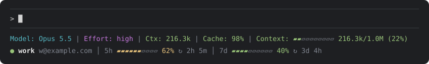

# claude-code-profile-switcher

Switch Claude Code's login between accounts with `/profile`. Each account is a full login: after a switch, `claude` opens on that account with its plan usage, email and claude.ai connectors. The plugin also shows which account you're on and how much of its plan you've used, and when an account runs out it moves the session to the next one, then to your Console API credit once every account is out, so the work carries on.

## Install

```
/plugin install profile --marketplace ultramenid/claude-code-profile-switcher
```

Works in the terminal. In the Code tab of the Claude desktop app, the account row, `/profile list`, `add` and `remove` work too, but switching doesn't: the app signs each of its sessions in with its own account, and Claude Code there ignores any other login or API key. Switch the app's account in the app.

> [!WARNING]
> **Switch only with `/profile`.** Claude Code refreshes the live login every few hours, and the old refresh key stops working. The plugin saves the latest version when you switch away with `/profile`. If the login changes another way (you run `/login`, or another open Claude Code window writes its old login back), that account's saved copy may stop working, and switching to it leaves you logged out.
>
> Fix: `/profile remove <name>`, then `/profile add <name>`, or `/login` while on it. Reopen other Claude Code windows after switching.

## Commands

| Command | Effect |
|---|---|
| `/profile` | Picker: switch to another signed-in account, or add one (a subscription account, as `/profile add <name>`, or API credit, as `/profile add api`) |
| `/profile list` | All accounts with email and last plan usage (`5h 23% 7d 40%`), and `api` with its key's last four characters; `●` marks the one this session uses |
| `/profile add <name>` | Opens a browser login for another account; a notice says when it's saved. Your current login stays live |
| `/profile <name>` | Makes that account the login. This session uses it from your next message; reopen for its usage, email and connectors |
| `/profile remove <name>` | Forgets a saved account (not the live one, or the one this session uses), with its usage readings |
| `/profile add api` | Sets up API credit: opens a box above the prompt; paste your Console API key (console.anthropic.com → API keys) and press Enter. The key goes to the plugin alone, never the prompt or its history |
| `/profile api` | Bills this session to that key now; `/profile <name>` goes back |
| `/usage` | On a switched session, the switched account's plan usage (5-hour and 7-day bars with reset times); otherwise Claude Code's own `/usage` |

Your login when you first use the plugin is saved as `main`. One `/profile add` runs at a time across all windows, and switching waits till it's done. A plugin reload mid-add picks the sign-in back up; `/profile remove` on a pending account cancels it from any window; after 10 minutes the add gives up. Either way the browser sign-in stops with it. A sign-in as an account already saved, or as the one you're on, isn't saved again: the add ends there and says so. Tip: do the browser login for `/profile add` in a private window, so it doesn't reuse the claude.ai account you're already signed into.

## When an account runs out


When a request is refused because the account's plan is used up (its 5-hour or 7-day window at 100%), the plugin switches to the next signed-in account with usage left, or to API credit once every account is out, and sends the same request again, so the turn carries on instead of ending:

- **While a goal runs** (a `/goal`, or one Claude sets), it switches by itself and says so in a notice: the goal keeps going instead of pausing. `/goal clear` also ends API credit the goal moved to by itself.
- **Otherwise it asks first**, offering the next account, API credit (once set up) and staying put: `main is out of usage. Continue on work, or on API credit (Console key …WXYZ, billed per token)?` Once every account is out, only API credit is left to offer. Stay, or dismiss it, and the turn ends as it would have; steps already running don't ask again till your next message.

An account with extra usage turned on isn't out at 100%: it counts as out only once its extra usage is off or at its monthly limit (from the plan's usage figures, what `/usage` reads). Subagents that run out together switch once, with one question; the rest wait and go again on the new account.

Accounts are tried in `/profile list` order. It skips one whose last reading has a used-up window that hasn't reset yet. A saved login that expired because no window used it for hours is renewed first; one that can't be is skipped (a notice names it: `/profile remove` and `/profile add` it again). The switch is a `/profile <name>`, with the same effects on other windows.

**API credit comes last**, and only if you've set it up with `/profile add api`: it's billed per token to your Console key, so a goal moves to it only once every account is out (when you're asked, you can pick it sooner). It applies to this session alone; other windows keep the live login. Once an account's window resets, the session goes back to it by itself (a notice says so). API credit you choose yourself stays until you `/profile <name>`: a `/profile api`, or picking it while an account still had usage.

If you also have the `api-fallback` plugin, turn its auto mode off (`/api auto off`) or uninstall it: both would move the same session, and its key can't take over from an account this plugin switched to.

## What you see

**In the terminal**, the plugin is your status line, in the style of ccstatusline:



**In the desktop app**, which has no status line, the same account row sits above the prompt (collapse it with `[-]`):


- **Model, Effort:** the session's model and its effort level, which follows `/effort` within seconds.
- **Ctx, Context:** how much of the context window the conversation fills.
- **Cache:** the share of the conversation's input tokens read from the prompt cache, counted from the first message the plugin saw.
- **5h, 7d:** the account's plan usage per window and the time until it resets (`↻`). Both come with each response, so they update together, and every window on that account shows the latest reading within seconds; after a `/profile` switch, the session reads them from the plan's usage figures instead (what `/usage` reads), when it switches and once a minute after. 7d shows only on an account that has a weekly limit.
- Numbers turn yellow and then red as a window or the context fills, and as the cache hit rate drops.
- On a narrow terminal the row above the prompt drops the email, then the reset countdowns, then Cache, then the 7d bar, so it stays on one line.

### Setup

None: the first time it runs, the plugin sets itself as the status line. It never replaces one you already have, and if you remove it, it stays removed. While you keep your own status line, the account row shows above the prompt in the terminal too, also in a project whose `.claude/settings.json` or `.claude/settings.local.json` sets its own.

To switch from your own status line to the plugin's, set this in `~/.claude/settings.json`:

```json
"statusLine": { "type": "command", "command": "sh ~/.claude/profile-statusline.sh", "refreshInterval": 1 }
```

To keep your own status line and add just the account row to it, run `sh ~/.claude/profile-statusline.sh row` with the status line's input on stdin: it prints this session's row (in ccstatusline: a Custom Command widget running it, with preserve colors on). `~/.claude/profile-status.txt` holds the row of whichever window wrote last.

After uninstalling the plugin, the status line prints nothing; remove the `statusLine` entry as well.

## How it works

`/profile add` runs `claude auth login`, which briefly makes the new account the live login; once it finishes, the plugin saves that login and puts your previous one back.

Claude Code keeps its login, and the account details in `oauthAccount` in `~/.claude.json`, in a place that depends on the OS. The plugin keeps a copy of both for each account next to it:

| OS | Claude Code's login | The plugin's saved accounts |
|---|---|---|
| macOS | Keychain entry `Claude Code-credentials` | Keychain, service `cc-swap-login` |
| Linux | `~/.claude/.credentials.json` | `~/.claude/profile-logins/<name>.json` (mode 600) |
| Windows | `%USERPROFILE%\.claude\.credentials.json` | `%USERPROFILE%\.claude\profile-logins\<name>.json` |

A switch saves the live login into the current account's copy (keeping any token refresh), then writes the target's copy into Claude Code's entry and `~/.claude.json`. Only the Claude login moves: MCP servers' sign-ins, kept in the same entry, stay as they are. A copy is never saved over another account's, a switch that can't read `~/.claude.json` or write the login stops before changing anything, and one that fails halfway puts the login back. On macOS, secrets go to `security` on stdin, never on the command line, which holds about 2 KB: a login past that (Claude Code's entry also keeps MCP servers' sign-ins) can't be switched, and the switch says so. On Linux each file is written whole and owner-only from its first byte. The account list and which one is live are read from those saved copies, so reinstalling the plugin loses nothing.

The Console key is kept the same way, as the account `api`. Switching to it touches no login: it sets `ANTHROPIC_API_KEY` in this session and clears the switched token (`ANTHROPIC_AUTH_TOKEN`), which Claude Code would send ahead of the key, then checks that the key is what goes out.

The status line is a small script, `~/.claude/profile-statusline.sh`, that prints a file the plugin keeps current for each session.

## Limitations

- **This session after a switch:** it loaded its login at start, so until you reopen, requests use the new account's access token, while Claude Code's own `/status` and claude.ai connectors still use the account the session started on. Plan usage still works: the plugin reads the new account's 5-hour and 7-day usage from the plan's usage figures as it switches and once a minute after, idle or not, and `/usage`, `/profile list`, the status line and the row above the prompt show it. Claude Code rotates that token when it refreshes it, which revokes the old copy; the plugin picks up the fresh one before each message and every minute. If no window is using that account, nothing in Claude Code refreshes it, so the plugin renews it itself once it expires, and renews an expired saved login before switching to it. Switching back to the account the session started on clears the token, so its usage and email show again without a reopen.
- **One login for all sessions:** every Claude Code window on this computer shares the live login. A switch moves new windows too, and an open window still on the old account may write its refreshed token back over the switch: reopen open windows after switching.
- **Remote Control:** Claude Code disconnects it whenever the signed-in account changes and shows a notice. The plugin runs `/remote-control` to reconnect it under the new account, in every open window, whichever one did the switch (each window checks every 5 seconds), where that window had Remote Control: you ran `/remote-control` there, the Claude mobile app is attached, or, in the terminal, `remoteControlAtStartup` is on. The desktop app's and VS Code's own auto-connect toggles can't be read by a plugin, so after a switch run `/remote-control` there yourself once.
- **The desktop app:** each of its sessions uses the app's own account, whatever the plugin sets, so `/profile <name>`, `/profile api` and switching when an account runs out work only in `claude` in a terminal. A desktop session shows the app's account in its row. A tested limit of Claude Code there, not something a plugin can change.
- **Windows is untested:** macOS is tested in daily use and Linux by the test suite; Windows follows the same file layout as Linux but hasn't been run yet, and the status line isn't set up there automatically. Reports welcome.
- **API credit:** while on it, claude.ai-only features (connectors, artifacts) are off, as in any API-key session. The key is in this session's environment as `ANTHROPIC_API_KEY`, as with `ANTHROPIC_API_KEY=… claude`. The plugin blanks it, and a switched account's token, out of every tool's output and every message the conversation keeps, so a command that prints the environment doesn't put it in the transcript; a command run there can still use it, so give the key a workspace spend limit. Switching to it approves the key for Claude Code the way its own prompt does (the key's last 20 characters under `customApiKeyResponses` in `~/.claude.json`).
- **A goal that ends by itself:** a plugin can't see a goal being met or judged impossible, so until `/goal clear` or `/clear` a used-up plan still switches without asking.
- `CLAUDE_CONFIG_DIR` isn't supported: the plugin swaps the default login only.
- With `CLAUDE_CODE_DISABLE_NONESSENTIAL_TRAFFIC` set, the plan's usage figures can't be read: a switched session shows no usage bars, and fails over only on a reading it already had.
- If something goes wrong, `/login` always gets you a working login again.
